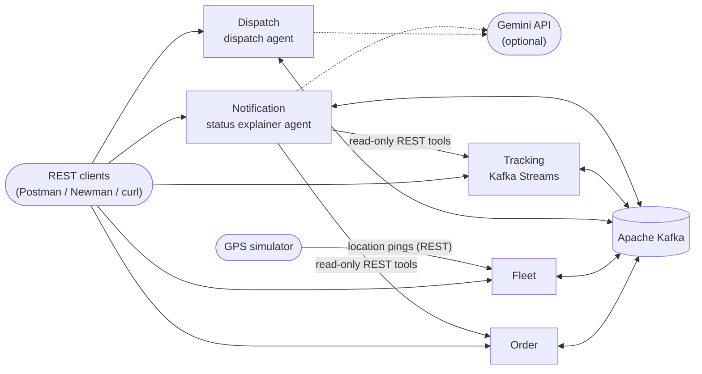

# FleetFlow

FleetFlow is a delivery and logistics tracking platform built as five Spring Boot
microservices that communicate through Apache Kafka (CSCI318 group project). It takes a
delivery order from placement to proof of delivery:

- it assigns a courier, using an LLM agent with a rule-based fallback;
- it tracks the courier's location as a stream, giving live ETAs, geofence alerts and
  risk detection;
- it reassigns deliveries when something goes wrong;
- it notifies the customer, and answers their questions through a second agent.

This README is for reviewers. It covers what the system is, how to run and configure
it, how to test it, sample inputs for each use case, and known limitations. The full requirements are in
[`docs/requirements-outline.md`](docs/requirements-outline.md), and the architecture
rules in [`docs/AGENTS.md`](docs/AGENTS.md).

**Contents**

1. [System overview](#1-system-overview)
2. [Running the system](#2-running-the-system)
3. [Configuration](#3-configuration)
4. [Testing](#4-testing)
5. [Sample inputs by use case](#5-sample-inputs-by-use-case)
6. [Behaviour notes and known limitations](#6-behaviour-notes-and-known-limitations)
7. [Further documentation](#7-further-documentation)

---

## 1. System overview

### Services

| Service | Port | Sub-domain | Use cases (requirements) | Responsibility |
|---|---|---|---|---|
| `order-service` | 8081 | Supporting | UC1 (FR1–FR3) | Order lifecycle, status history, cancellation |
| `fleet-service` | 8082 | Supporting | UC2 (FR4–FR6), UC5 (FR10) | Courier profiles, shifts, load against capacity, latest location |
| `dispatch-service` | 8083 | **Core** | UC3 (FR7, FR8), UC4 (FR9) | Courier assignment (agent first, rules as fallback), reassignment, operator exception queue |
| `tracking-service` | 8084 | **Core** | UC6 (FR11–FR13), UC7 (FR14) | Kafka Streams ETA, geofencing and risk detection; deliveries and proof of delivery |
| `notification-service` | 8085 | Generic | UC8 (FR15, FR16) | Templated in-app notifications; conversational status explainer agent |

Two further modules are not services:

- **`gps-simulator`** is an external client that posts location pings to Fleet's REST
  endpoint. It has no Kafka access.
- **`fleetflow-contracts`** is the shared library of event records: the published
  language between the services
  ([ADR 0004](docs/decisions/0004-fleetflow-contracts-published-language.md)).

Each service owns its own H2 database. There are no shared tables or cross-service
foreign keys, and services refer to each other's data by ID only.

### Architecture



The services interact only through Kafka events, with two exceptions:

- the GPS simulator posts pings to Fleet over REST;
- the explainer agent in Notification reads Order and Tracking through read-only REST
  calls.

Dispatch never calls Fleet. It keeps its own read model of courier availability, built
from Fleet's events.

### Event flow

Topics are named `fleetflow.<context>.<event-kebab-case>`, for example
`fleetflow.order.order-placed`. Each event is published by the service that owns the
aggregate.

| Event | Published by | Consumed by |
|---|---|---|
| `OrderPlaced` | Order | Dispatch, Tracking |
| `OrderCancelled` | Order | Dispatch, Fleet, Tracking |
| `CourierRegistered` | Fleet | Dispatch, Tracking |
| `CourierAvailabilityChanged` | Fleet | Dispatch |
| `CourierLocationUpdated` | Fleet | Dispatch, Tracking (Kafka Streams) |
| `CourierLoadChanged` | Fleet | Dispatch |
| `OrderAssigned` | Dispatch | Order, Fleet, Tracking, Notification |
| `OrderReassigned` | Dispatch | Fleet, Tracking, Notification |
| `AssignmentFailed` | Dispatch | Order, Notification |
| `DeliveryStarted` | Tracking | Order, Dispatch, Notification |
| `DeliveryEtaUpdated` | Tracking | Tracking (status read model) |
| `DeliveryNearDestination` | Tracking | Notification |
| `DeliveryArrived` | Tracking | Dispatch, Tracking |
| `DeliveryAtRisk` | Tracking | Dispatch, Tracking (status read model), Notification |
| `DeliveryCompleted` | Tracking | Order, Fleet, Dispatch, Notification |
| `NotificationSent` | Notification | Audit only (no consumer) |

Consumers are idempotent: a duplicate event changes nothing. A message that keeps
failing goes, after retries, to a dead-letter topic named
`error.<source-topic>.<service>`.

### Agentic AI and stream processing

- **Dispatch agent (FR8).** Fired by each `OrderPlaced` event. A LangChain4j agent with
  read-only tools reasons over the open-order backlog and courier availability, then
  proposes an assignment with a justification.
  - If the agent takes longer than 5 seconds, fails, or proposes an ineligible
    courier, the deterministic rule (FR7) picks the nearest eligible courier by zone,
    capacity and proximity.
  - Every decision, and which path made it, is recorded in `assignment_decisions`.
- **Status explainer agent (FR16).** A conversational REST endpoint. The agent uses
  read-only tools to fetch the order's state and the live ETA and risk flags, then
  answers in plain language. If no model is configured, or the model's output is
  invalid, it returns a factual fallback answer.
- **Kafka Streams in Tracking (FR11–FR13).** Four topologies join
  `CourierLocationUpdated` with each courier's active deliveries:
  - ETA recalculation: Haversine distance divided by the configured speed for the
    vehicle type; no routing API is used.
  - Near destination, within 500 m.
  - Arrival, within 50 m.
  - Windowed risk detection: `STATIONARY`, `OFF_PACE` or `SLA_BREACH`.

### Key design decisions

| Decision | Record |
|---|---|
| The agent is the primary assignment path; rules are the fallback after the 5-second limit | [requirements §UC3](docs/requirements-outline.md), [ADR 0012](docs/decisions/0012-dispatch-capacity-reservations-and-zones.md) |
| Dispatch keeps local read models instead of calling Fleet | [ADR 0001](docs/decisions/0001-dispatch-open-orders-backlog.md), [ADR 0009](docs/decisions/0009-fleet-publishes-courier-load-changed.md) |
| At most one automatic reassignment per delivery, then a 10-minute cooldown, then the operator queue | [ADR 0017](docs/decisions/0017-uc4-durable-reassignment-guard.md) |
| Location events keyed by courier, with an internal snapshot topic for the stream-table joins | [ADR 0010](docs/decisions/0010-fr11-internal-topic-and-rekeying.md), [ADR 0013](docs/decisions/0013-uc6-windowed-risk-and-delivery-snapshots.md) |
| Geofence thresholds, and separate topologies for near-destination and arrival | [ADR 0011](docs/decisions/0011-fr12-geofence-thresholds-and-function-split.md) |
| Order status history and write consistency | [ADR 0006](docs/decisions/0006-order-status-history-persistence.md), [ADR 0007](docs/decisions/0007-order-items-and-write-consistency.md) |
| Proof of delivery, and the tracking status read model | [ADR 0014](docs/decisions/0014-FR14-completion-proof.md), [ADR 0016](docs/decisions/0016-tracking-status-read-model.md) |
| Notification inbox and outbox | [ADR 0015](docs/decisions/0015-uc8-isolated-notification-integration.md) |

### Code structure

Every service uses the same four layers:

```
com.fleetflow.<service>
├── api/             REST controllers and DTOs
├── application/     use-case orchestration and transactions
├── domain/          entities, value objects, aggregates, domain services
└── infrastructure/  JPA repositories, Kafka producers/consumers, LLM clients
```

`gps-simulator` (a flat client package) and `fleetflow-contracts` (event records only)
deliberately don't follow this structure, because neither is a bounded-context
service.

---

## 2. Running the system

### Docker (recommended)

You only need Docker Desktop (with the WSL 2 backend on Windows); Java and Maven are
not required. From the repository root:

```
docker compose up -d --build     # build and start Kafka, the five services, Kafka UI and Dozzle
docker compose ps                # wait until all five services show "healthy" (about a minute)
docker compose run --rm demo     # run the end-to-end demo (see section 4)
docker compose down -v           # stop everything and delete all data
```

The first build downloads every dependency and takes a few minutes; later builds are
cached.

While the system runs, these are available:

| What | Where |
|---|---|
| Service REST APIs | http://localhost:8081 to http://localhost:8085 |
| Kafka UI: topics and the messages flowing through them | http://localhost:8080 |
| Dozzle: live logs from every container | http://localhost:9999 |
| Report from the last demo run | `demo/reports/fleetflow-demo.html` |

Use `down -v` before starting a fresh review session. A plain `down` leaves Kafka's
data volume behind. Rebuilding while the system is running resets the services'
databases but keeps Kafka's topics and consumer offsets, which leaves them out of step.

### Locally with Maven

Requires JDK 21 and Maven 3.9+. Every service needs a Kafka broker. The Compose file
can provide one on its own:

```
docker compose up -d kafka                       # broker on localhost:9094
mvn clean install                                # build all modules and run all tests
```

Then start each service in its own terminal, pointing it at that broker, for example
in PowerShell:

```
$env:KAFKA_BROKERS="localhost:9094"; mvn -pl order-service spring-boot:run
```

You can also run a service as a jar:
`java -jar order-service/target/order-service-0.1.0-SNAPSHOT.jar`. Each service keeps
its H2 database in a `data/` folder under its working directory. That folder is
`<service>/data/` when started with `spring-boot:run`, and `./data/` when started
with `java -jar` from the repository root. Delete the folder to reset.

To work on a single service while the rest run in Docker, stop its container
(`docker compose stop <service>`) and run it locally with
`KAFKA_BROKERS=localhost:9094`. Note that the containerised Notification service
still reaches Order and Tracking by their container names.

---

## 3. Configuration

### Environment variables

| Variable | Used by | Default | Purpose |
|---|---|---|---|
| `KAFKA_BROKERS` | all services | `localhost:9092` (`kafka:9092` in Docker) | Kafka bootstrap servers |
| `GEMINI_API_KEY` | Dispatch, Notification | empty | Turns on the two LLM agents. When empty, the rule-based assignment and the factual explainer answer are used |
| `GEMINI_MODEL` | Dispatch, Notification | `gemini-2.0-flash` | Model name ([ADR 0005](docs/decisions/0005-llm-model-selection.md)) |
| `ORDER_SERVICE_URL` | Notification | `http://localhost:8081` | Order REST base URL for the explainer and recipient lookup |
| `TRACKING_SERVICE_URL` | Notification | `http://localhost:8084` | Tracking REST base URL for the explainer |
| `TRACKING_STATUS_PATH` | Notification | `/deliveries/order/{orderId}/status` | Tracking status path |
| `SERVER_PORT` | all services | each service's port | Set by Docker Compose; it matches each `application.yml` |

For Docker, put `GEMINI_API_KEY` in a `.env` file at the repository root. Copy
[`.env.example`](.env.example) to start; `.env` is gitignored. The whole system works,
and the demo passes, without a key.

### Application settings

Each service's settings live in `<service>/src/main/resources/application.yml`.

| Setting | Service | Default | Meaning |
|---|---|---|---|
| `dispatch.zones` | Dispatch | `ZONE_A` (Wollongong), `ZONE_B` (Sydney) | Latitude/longitude bounds of each operating zone. A courier is eligible only for pickups inside its zone |
| `tracking.eta.speed-kmh.*` | Tracking | bicycle 15, motorcycle 35, car 30, van 28, truck 22 | Average speed per vehicle type, used for the ETA |
| `tracking.risk.*` | Tracking | 10-minute window, 5-minute minimum observation, 30 m stationary radius, 10-minute alert cooldown | Risk detection thresholds ([ADR 0013](docs/decisions/0013-uc6-windowed-risk-and-delivery-snapshots.md)) |
| `notification.worker.poll-ms` | Notification | 5000 | How often pending notifications are delivered |
| `simulator.*` | GPS simulator | Fleet at `http://localhost:8082`, every 5000 ms | Target Fleet URL, courier ID and ping interval |

### Ports

| Port | Component |
|---|---|
| 8081–8085 | Order, Fleet, Dispatch, Tracking, Notification |
| 9092 | Kafka inside the Docker network (`kafka:9092`) |
| 9094 | Kafka from the host (`localhost:9094`) |
| 8080 | Kafka UI |
| 9999 | Dozzle log viewer |

---

## 4. Testing

### Automated tests

Each service has JUnit 5 unit, API (MockMvc) and H2 persistence tests. Integration
tests (`*IntegrationTest`) run against a real Kafka broker started by Testcontainers.
These need Docker running; the broker is never mocked.

| Goal | Command |
|---|---|
| Everything, including the Kafka integration tests | `mvn clean install` |
| One service, including its integration tests | `mvn -pl tracking-service -am test` |
| Everything except the integration tests (no Docker needed) | `mvn test "-Dtest=*Test,!*IntegrationTest" "-Dsurefire.failIfNoSpecifiedTests=false"` |
| Order's real-Kafka test (off by default) | `mvn -pl order-service -am test "-Dkafka.integration=true"` |

Keep the quotes around `-D...` arguments: Windows PowerShell splits an unquoted
`-Dname.with.dots=value` at the first dot. Integration tests use isolated in-memory
databases and their own broker on a random port, so they don't affect a running
system.

### End-to-end demo

[`demo/fleetflow-demo.postman_collection.json`](demo/fleetflow-demo.postman_collection.json)
exercises every use case against the running system. Each request has assertions that
state what the step demonstrates. There are two ways to run it:

- **Automated:** `docker compose run --rm demo` runs the collection with Newman. It
  prints a pass/fail line for each step, writes `demo/reports/fleetflow-demo.html`, and
  exits with a non-zero code if any assertion fails. It takes about two minutes and
  can be re-run straight away.
- **By hand:** import the collection into Postman and run the folders in order, one
  request at a time or with the Collection Runner. The variables point at
  `localhost:8081`–`8085`.

| Folder | Demonstrates |
|---|---|
| 1 | Courier registration, going on shift, first location ping (UC2, UC5) |
| 2 | Order placement and automatic courier assignment (UC1, UC3) |
| 3 | Live ETA, near-destination and arrival detection (UC6) |
| 4 | Customer inbox and status explainer, with a follow-up question (UC8) |
| 5 | Completion with proof of delivery, and a safe retry (UC7) |
| 6 | SLA risk detected on the first ping; a reassignment attempt with no replacement; escalation (UC6, UC4) |
| 7 | Reassignment when a courier goes offline mid-delivery (UC4) |
| 8 | Cancellation rules, including a cancellation racing an assignment (UC1) |
| 9 | Courier deactivation (UC2) |
| 10 | Assignment failure for an order outside every zone (UC3, UC8) |
| 11 | Tidy-up, so the collection can be run again |

Requests marked "(waits)" pause for the `settleMs` collection variable (6000 ms) so
that events can flow between services. Raise it on a slow machine. The operator queue
in step 6.8 fills only after the 10-minute cooldown, so send that request again later
to see the escalation.

While the demo runs, Kafka UI (http://localhost:8080) shows each event arriving on its
topic, and Dozzle (http://localhost:9999) shows every service's log side by side.

---

## 5. Sample inputs by use case

These requests show each use case by hand. Send them in the order given, because
later steps use IDs from earlier ones. The Postman collection contains the same
requests, ready to run.

- Every request body is JSON, sent with the header `Content-Type: application/json`.
- `{courierA}`, `{orderId}` and so on stand for IDs returned by earlier requests:
  `courierId` from courier registration, and `id` from orders and deliveries.
- `{customerId}` can be any UUID you choose, for example
  `3f2b8c1e-6d4a-4f7b-9a1e-2c5d8e7f9a10`.
- `{in 2 hours}` means a future ISO-8601 UTC timestamp, for example
  `2026-10-18T12:00:00Z`.
- All coordinates are inside the demo `ZONE_A` (Wollongong, NSW).
- Events take a few seconds to flow between services, so wait briefly after each
  step that triggers one.

### UC2 — Manage fleet and courier profiles (FR4–FR6)

Register courier A: `POST http://localhost:8082/api/couriers`

```json
{"vehicleType":"VAN","capacity":3,"operatingZone":"ZONE_A"}
```

Save the returned `courierId` as `{courierA}`. Valid vehicle types are `BICYCLE`,
`MOTORCYCLE`, `CAR`, `VAN` and `TRUCK`. A new courier is off shift until it goes on
shift.

Put courier A on shift: `PATCH http://localhost:8082/api/couriers/{courierA}/availability`

```json
{"available":true}
```

Update the profile: `PUT http://localhost:8082/api/couriers/{courierA}`

```json
{"vehicleType":"VAN","capacity":4,"operatingZone":"ZONE_A"}
```

View courier A (profile, shift status and active-order count):
`GET http://localhost:8082/api/couriers/{courierA}`. List all couriers:
`GET http://localhost:8082/api/couriers`.

To see deactivation, register a second courier C, put it on shift, then deactivate it:

`POST http://localhost:8082/api/couriers`

```json
{"vehicleType":"BICYCLE","capacity":1,"operatingZone":"ZONE_A"}
```

`POST http://localhost:8082/api/couriers/{courierC}/deactivate` (no body). Then send
`{"available":true}` to `PATCH .../{courierC}/availability`: a deactivated courier
can't go back on shift, so this is refused with 409.

### UC5 — Capture courier location (FR10)

Report courier A's position near the pickup: `POST http://localhost:8082/api/couriers/{courierA}/location`

```json
{"latitude":-34.4060,"longitude":150.8790}
```

To have the GPS simulator send pings instead (random walk, every 5 seconds):

```
mvn -pl gps-simulator spring-boot:run "-Dspring-boot.run.arguments=--simulator.courier-id={courierA}"
```

### UC1 — Manage delivery order (FR1–FR3)

Place an order: `POST http://localhost:8081/orders`

```json
{
  "customerId": "{customerId}",
  "pickupStreet": "Northfields Ave", "pickupSuburb": "Wollongong",
  "pickupState": "NSW", "pickupPostcode": "2522",
  "pickupLatitude": -34.4054, "pickupLongitude": 150.8784,
  "dropoffStreet": "Crown St", "dropoffSuburb": "Wollongong",
  "dropoffState": "NSW", "dropoffPostcode": "2500",
  "dropoffLatitude": -34.4248, "dropoffLongitude": 150.8931,
  "packageDetails": "Textbooks",
  "serviceLevel": "STANDARD",
  "requestedDeliveryBy": "{in 2 hours}",
  "items": [{"description": "Textbook", "quantity": 2}]
}
```

`items` is optional. Without it, `packageDetails` becomes a single item.

Query status and history: `GET http://localhost:8081/orders/{orderId}`. Within a few
seconds the order moves from `PLACED` to `ASSIGNED` to `IN_TRANSIT` (see UC3 and UC6).

Cancel an order: `POST http://localhost:8081/orders/{orderId}/cancel` (no body).
Cancellation is accepted only while the order is still `PLACED`; once it is assigned,
the request is refused with 409. Sent by hand a few seconds after placing the order,
the cancel usually arrives after Dispatch has assigned it, so you will see the 409.
An accepted cancellation needs the place and cancel requests sent back to back, which
the demo collection does in step 8.4. If the cancel wins, Dispatch releases the
assignment, Fleet releases the courier's load, and Tracking never starts the
delivery.

### UC3 — Assign courier to order (FR7, FR8)

Assignment has no endpoint of its own: Dispatch reacts to the `OrderPlaced` event from
UC1. If courier A is on shift with a location in `ZONE_A`, the order becomes `ASSIGNED`
to courier A. The agent makes the assignment when `GEMINI_API_KEY` is set; otherwise
the rule-based fallback does.

To see an assignment fail, place an order whose pickup is outside every zone:
`POST http://localhost:8081/orders`

```json
{
  "customerId": "{customerId}",
  "pickupStreet": "Swanston St", "pickupSuburb": "Melbourne",
  "pickupState": "VIC", "pickupPostcode": "3000",
  "pickupLatitude": -37.8136, "pickupLongitude": 144.9631,
  "dropoffStreet": "Lygon St", "dropoffSuburb": "Carlton",
  "dropoffState": "VIC", "dropoffPostcode": "3053",
  "dropoffLatitude": -37.7990, "dropoffLongitude": 144.9670,
  "packageDetails": "Parcel",
  "serviceLevel": "STANDARD",
  "requestedDeliveryBy": "{in 2 hours}"
}
```

`GET http://localhost:8081/orders/{failedOrderId}` then shows `FAILED`.

### UC6 — Monitor delivery in real time (FR11–FR13)

Find the delivery that Tracking started for the order:
`GET http://localhost:8084/api/deliveries?orderId={orderId}`. Save its `id` as
`{deliveryId}`.

Move courier A towards the drop-off by sending these pings in turn to
`POST http://localhost:8082/api/couriers/{courierA}/location`:

```json
{"latitude":-34.4150,"longitude":150.8860}
```
```json
{"latitude":-34.4220,"longitude":150.8915}
```
```json
{"latitude":-34.4249,"longitude":150.8932}
```

The first ping updates the ETA. The second is within 500 m of the drop-off, so it
publishes near-destination. The third is within 50 m, so it publishes arrival.

Check the live ETA and risk flags:
`GET http://localhost:8084/deliveries/order/{orderId}/status`.

To see SLA risk detection, place an order whose drop-off is 12 km away and that is due
in one minute: `POST http://localhost:8081/orders`

```json
{
  "customerId": "{customerId}",
  "pickupStreet": "Northfields Ave", "pickupSuburb": "Wollongong",
  "pickupState": "NSW", "pickupPostcode": "2522",
  "pickupLatitude": -34.4054, "pickupLongitude": 150.8784,
  "dropoffStreet": "Lawrence Hargrave Dr", "dropoffSuburb": "Thirroul",
  "dropoffState": "NSW", "dropoffPostcode": "2515",
  "dropoffLatitude": -34.3176, "dropoffLongitude": 150.9211,
  "packageDetails": "Urgent documents",
  "serviceLevel": "EXPRESS",
  "requestedDeliveryBy": "{in 1 minute}"
}
```

Once the delivery has started, send one ping for courier A, still in Wollongong:
`{"latitude":-34.4249,"longitude":150.8932}`. Then
`GET http://localhost:8084/deliveries/order/{riskOrderId}/status` shows `SLA_BREACH`
in `riskFlags`.

### UC7 — Complete delivery and record proof (FR14)

Complete the first delivery: `POST http://localhost:8084/api/deliveries/{deliveryId}/complete`

```json
{
  "courierId": "{courierA}",
  "routeSummary": "Northfields Ave via Princes Hwy to Crown St",
  "confirmation": "Received by Alex at reception"
}
```

Sending the identical request again is safe: it returns the original record and
publishes nothing. Changing the proof, or giving a different courier ID, is refused
with 409.

Read the delivery record: `GET http://localhost:8084/api/deliveries/{deliveryId}`.
The order (`GET http://localhost:8081/orders/{orderId}`) is now `DELIVERED`, and
courier A's active-order count is back to 0.

### UC8 — Notify and explain delivery status (FR15, FR16)

Customer inbox (newest first): `GET http://localhost:8085/notifications?customerId={customerId}`

Ask the explainer about an order: `POST http://localhost:8085/orders/{orderId}/explanations`

```json
{"question":"Where is my order and when will it arrive?"}
```

Ask a follow-up in the same conversation, using the `conversationId` from the
previous answer:

```json
{"question":"Is anything delaying it?","conversationId":"{conversationId}"}
```

For the at-risk order from UC6, try `{"question":"Why is my delivery going to be late?"}`.
More detail is in the [Notification guide](notification-service/README.md).

### UC4 — Handle delivery exception (FR9)

Place another order with the UC1 body; it is assigned to courier A. Then bring courier
B on shift near courier A. First `POST http://localhost:8082/api/couriers`:

```json
{"vehicleType":"VAN","capacity":3,"operatingZone":"ZONE_A"}
```

then `PATCH .../{courierB}/availability` with `{"available":true}`, and
`POST .../{courierB}/location` with:

```json
{"latitude":-34.4245,"longitude":150.8925}
```

Now take courier A offline mid-delivery:
`PATCH http://localhost:8082/api/couriers/{courierA}/availability`

```json
{"available":false}
```

`GET http://localhost:8084/api/deliveries?orderId={reassignOrderId}` shows the same
delivery now assigned to courier B. Each delivery gets only one automatic
reassignment. Exceptions that remain unresolved after the 10-minute cooldown, such as
the at-risk order from UC6, appear in the operator queue:
`GET http://localhost:8083/api/dispatch/exceptions`.

---

## 6. Behaviour notes and known limitations

**Applies to every service**

- No API authenticates the caller. IDs such as `customerId` and `courierId` select
  records; they don't authorise access.
- Invalid input returns 400, an unknown ID returns 404, and a request that breaks a
  business rule returns 409.

**Order**

- Status only moves forward: `PLACED` → `ASSIGNED` → `IN_TRANSIT` → `DELIVERED`, or
  `FAILED` from `PLACED`. `DELIVERED`, `FAILED` and `CANCELLED` are final, so
  duplicate or late events change nothing.
- Each status change is timestamped with the source event's time.
- Repeating a cancellation doesn't publish a second `OrderCancelled`.
- Each item has a description of 1–255 characters and a positive quantity. Orders
  created before items were introduced may have an empty item list.

**Fleet**

- Capacity can't be reduced below a courier's current load.
- Deactivation is idempotent. It also takes an on-shift courier off shift, which
  publishes `CourierAvailabilityChanged`, because the event catalogue has no
  deactivation event.
- Profile updates (`PUT`) are stored in Fleet only. There is no profile-update
  event, so Dispatch and Tracking keep the values from registration.

**Dispatch**

- The operator queue lists each order, delivery and courier, the reason, the attempt
  time and the escalation time.
- Manual reassignment from the queue is not implemented.

**Tracking: status endpoint**

- A `null` `estimatedArrival` means there is no ETA yet.
- `riskFlags` lists only reasons raised within the last 12 minutes (alert cooldown
  plus maximum ping gap); an older reason is treated as cleared.
- `[]` means no current risk, including after arrival, completion or cancellation.

**Tracking: proof of delivery**

- The route summary and confirmation are text supplied by the courier, each 1–255
  characters after trimming. The route summary is not rebuilt from GPS, and photos
  and signatures are not stored.
- The courier ID in a completion is checked against the assignment.

**Tracking: Kafka Streams and consistency**

- A GPS ping that arrives before Tracking has loaded the delivery's snapshot is not
  matched; the next ping is.
- Kafka Streams writes with `exactly_once_v2`. A consumer that must see only
  committed output needs `isolation.level=read_committed`.
- The H2 database and Kafka are not updated atomically. If the database commit fails
  after a successful send, the event can still be published.
- On startup, Tracking republishes delivery snapshots from its database, so keep the
  database when upgrading rather than deleting it.

**Notification**

- Messages for cancelled orders are suppressed.
- Audit events (`NotificationSent`) are delivered at least once.
- Delivery guarantees are described in the [Notification guide](notification-service/README.md).

---

## 7. Further documentation

| Document | Contents |
|---|---|
| [`docs/requirements-outline.md`](docs/requirements-outline.md) | Business objectives, use cases, all 16 functional requirements, event catalogue |
| [`docs/AGENTS.md`](docs/AGENTS.md) | Architecture constraints, DDD patterns, data ownership |
| [`docs/decisions/`](docs/decisions/) | Architecture decision records (ADRs 0001–0017) |
| [`docs/prompts/`](docs/prompts/) and [`docs/ai-collaboration-log.md`](docs/ai-collaboration-log.md) | Record of AI-assisted development |
| [`notification-service/README.md`](notification-service/README.md) | UC8 REST contracts, delivery guarantees and tests |
